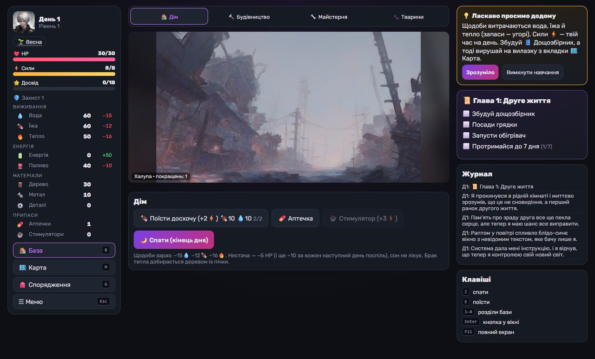

# Попіл і Туман

Аніме-виживання в мертвому місті. Підліток прокидається у своєму домі вдруге — з памʼяттю про перше життя, про друга, що його зрадив, і з дивною «Системою», яку бачить лише він. Відбудовуй базу, ходи на вилазки, бийся картками зброї, підбирай тварин і дійди до Серця Туману.



**Платформи:** браузер (PWA, працює офлайн), Android (APK), Windows (інсталятор або переносна `.exe`). Мови: українська, англійська.

## Що в грі

- **Виживання на 120 днів:** вода, їжа й тепло щодня; витрати ростуть разом із героєм і базою, взимку тепла треба вдвічі більше.
- **База:** дощозбірник, город і теплиця, генератор → сонячна панель → обігрівач, ліжко, стіни з тривогою, майстерня, рюкзак. Будівлі зношуються й ламаються.
- **Вилазки:** 36 локацій у 4 зонах, у кожної свій запас, що вичерпується і відновлюється. Монстри, рідкісні істоти з трофеями, вижилі, що памʼятають, як ти з ними повівся.
- **Бої:** покрокові, з колодою з твоєї зброї (32 види, 5 рідкісностей), блоком і суператакою. Вночі мародери можуть напасти на базу.
- **Тварини:** пес, кіт, папуга, єнот, ворона, коза — ростуть, ходять з тобою і бʼються.
- **Сюжет:** 6 глав, боси, фінал.
- **Онлайн (за бажанням):** акаунт і хмарні збереження (одна гра на всіх пристроях), друзі й дуелі з їхніми героями, зустрічі з героями інших гравців у вилазках, чат. Без входу гра повністю офлайн.

## Запуск

Потрібен Node.js 22+.

```powershell
npm install
npm run dev        # гра в браузері: http://localhost:5173
npm run build      # збірка вебверсії в dist/
npm run desktop    # ПК-вікно (Electron)
```

| Команда | Що робить |
|---|---|
| `npm run smoke` | бот грає 50 коротких ігор без браузера й перевіряє міграції збережень |
| `npm run sim` | симулятор балансу: 150 ігор × 120 днів, цілі в `tools/sim.config.json` |
| `npm run exe` | інсталятор і переносна `.exe` для Windows → `dist-desktop/` |
| `npm run apk` | APK для Android → `dist-apk/` (потрібні JDK 21 і Android SDK, шляхи — у `tools/apk.cmd`) |
| `npm run i18n` | зібрати нові рядки інтерфейсу й перекласти їх англійською |

**Вебверсія онлайн:** `.github/workflows/pages.yml` збирає гру й викладає на GitHub Pages при кожному пуші в `main` (увімкнути: Settings → Pages → Source: GitHub Actions).

APK підписується ключем поза репозиторієм (`android/app/build.gradle` читає `keystore.properties`); без нього збереться debug-версія зі стандартним ключем Android.

## Як влаштовано

- Vite + ES-модулі без фреймворку. Логіка — `src/`, екрани — `src/ui/`, усі числа балансу й вміст — `data/*.json`.
- Логіка не торкається DOM, тому ганяється в Node: на цьому стоять `smoke` і `sim`.
- Збереження з версіями й міграціями (`src/save.js`), 3 слоти, резервна копія текстом або файлом.
- Детальний план, рішення і поточні числа — у [`PLAN.md`](PLAN.md).

## Онлайн

Сервер — [Supabase](https://supabase.com) (безкоштовний тариф). Схема бази — `supabase/schema.sql`: виконати в SQL Editor свого проєкту, потім вписати Project URL і publishable-ключ у `src/online/config.js`. Ключ публічний за задумом: доступ до даних обмежують правила RLS у схемі.

## Арт, тексти й звук

Усе згенеровано заздалегідь локально і вшито в гру.

| Що | Модель | Інструмент |
|---|---|---|
| Ілюстрації | Pony Diffusion V6 XL (ComfyUI) | `tools/art/generate.py` |
| Тексти NPC, описи, переклад | Qwen3.5-35B-A3B (llama.cpp) | `tools/text/generate.py`, `tools/i18n/translate.py` |
| Звуки | Stable Audio Open 1.0 (ComfyUI) | `tools/audio/generate.py` |
| Музика | ACE-Step 1.5 (ComfyUI) | `tools/audio/generate.py` |

Сюжет і переклад інтерфейсу написані вручну. Шрифт — Rubik (SIL Open Font License).

Моделі мають власні ліцензії; згенерований вміст використовується в некомерційному проєкті. Stable Audio Open — Powered by Stability AI.

---

**Ash and Fog** — an anime survival game in a dead city (Ukrainian and English). Rebuild your base, scavenge 36 locations, fight with a deck made of your weapons, raise pets and finish a 120-day story. Runs in the browser (offline PWA), on Android and on Windows. `npm install && npm run dev` to play locally.
